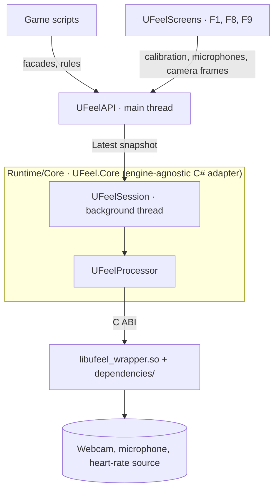

# Architecture

> [<- Back to README](README.md)

The UFeel Unity Game Hub is a Unity project demonstrating the **UFeel** native library (emotions, eye tracking, speech to text, heart rate).

## Package (`Packages/com.ufcorp.ufeel`)

| Path | Role |
| --- | --- |
| `Runtime/Core/` | C# adapter synced from the ufeel package (`tools/update-ufeel.sh`). Do not edit here, change it in the ufeel repo. |
| `Runtime/UFeelAPI.cs` | Unity host: starts the session, loads the calibration profile, evaluates rules in `Update`, disposes on quit. |
| `Runtime/Facades/` | `UFeelAPI.Emotion`, `.EyeTracking`, `.SpeechToText`, `.HeartRate`, `.CameraFeed`: read the per-frame snapshot and keep the read features running. |
| `Runtime/CameraFeed/` | Copies the webcam frames for `UFeelAPI.CameraFeed` while capturing. |
| `Runtime/Plugins/Linux-x86_64/` | Native library, `dependencies/` (found through RUNPATH) and `models/`. |
| `Editor/` | Plugin import settings, and the Linux post-build step copying `dependencies/` and `models/` (to `StreamingAssets/UFeel`). |

## Threading

- Native calls run only on the session thread.
- Game code reads immutable snapshots and never blocks.
- Commands (calibration, speech toggle, microphone selection) are queued through `UFeelSession.ExecuteAsync`.

## Project layout (`Assets`)

| Path | Role |
| --- | --- |
| `Hub/` | `GameHub` scene: first-person lobby with the door carousel, door selection (keyboard, dropdown or eye tracking) and additive loading of the games. `Hub/Editor/` holds the carousel builder (**Tools > Game Hub > Carousel Builder**) and its `CarouselLayout.json`. |
| `Common/` | Code shared by the hub and the games: UI kit, pause menu, settings, UFeel screens, keyboard-layout-aware input, gaze direction, first-person controller, return to the hub, heart rate tempo, tags and scene names. `Common/Resources/Fonts` holds the Barlow Semi Condensed font assets, `Common/Resources/Audio/GameMixer` the audio mixer. |
| `Games/<Category>/<Game>/` | One folder per game (`Scenes`, `Scripts`, and the game's own `Prefabs`, `Materials`, `Audio`, `Sprites`, `Textures` or `Models`). |
| `ThirdParty/` | Imported packs and models, kept as distributed. |
| `Settings/` | URP assets and the Input System actions. |

## Assemblies

Each feature compiles into its own assembly, named after its root namespace. Game assemblies never reference each other.

| Assembly | Folder | References |
| --- | --- | --- |
| `GameHub.Common` | `Common/Scripts` | `UFeel`, `UFeel.Core`, Input System, TextMesh Pro, UI |
| `GameHub.Hub` | `Hub/Scripts` | `GameHub.Common`, `UFeel`, `UFeel.Core`, TextMesh Pro, UI |
| `GameHub.Hub.Editor` | `Hub/Editor` | `GameHub.Hub` |
| `GameHub.RhythmGame.Editor` | `Games/HeartRate/RhythmGame/Editor` | `GameHub.RhythmGame` |
| `GameHub.Maze`, `GameHub.Animals`, `GameHub.Car`, `GameHub.Survivor`, `GameHub.HorrorRoom`, `GameHub.RhythmGame`, `GameHub.EscapeRoom` | `Games/<Category>/<Game>/Scripts` | `GameHub.Common`, `UFeel`, `UFeel.Core`, and UI or TextMesh Pro when used |

## Scene flow

The hub loads a game additively when the player enters a door. A game whose root object is named `Root` is placed behind the door, otherwise the hub player and environment are hidden. Games return to the hub with `GameFlow.ReturnToHub()`, which reloads the `GameHub` scene and stops speech detection. A door shows "In progress" when flagged so or when its scene is not in the build settings.

## Settings and audio

`GameSettings` saves the player settings in `PlayerPrefs` and applies them at startup. The master volume sets `AudioListener.volume`. The music and effects volumes set the `MusicVolume` and `EffectsVolume` parameters of `GameMixer`, so every audio source must output to its Music or Effects group: set **Output** in the inspector, or call `GameAudio.Route` for sources created in code. `FirstPersonController` multiplies its sensitivity by `GameSettings.LookMultiplier`.

## UI

| Component | Role |
| --- | --- |
| `Theme` | Text sizes, margins and colours |
| `UiKit` | `UiKit.Shared`: generated sprites, Barlow fonts, factories for rects, images, texts and edge shades |
| `UiCanvas` | Screen-space canvas at 1920x1080, with the sort orders of the hub, games, pause menu and UFeel screens |
| `UiLayout` | Anchoring helpers |
| `UiFocus`, `MenuCover` | The open menu that receives the input. Screens below it ignore the keys, and canvases below the pause menu fade out |
| `MenuList`, `ListScreen` | Animated list with keyboard, mouse and wheel input, and a titled list screen |
| `KeyBar`, `KeyHint` | Key hints at the bottom of the screen, clickable |
| `GazeDwell`, `GazeMenuInput`, `GazeIndicator` | Gaze held to one side for a moment as a step, eye control of a menu (look left or right to move, close the eyes to select) and its feedback (`GazeDwell` and `GazeMenuInput` are in `Common/Scripts/Input`) |
| `SliderView`, `MeterView`, `StatView`, `LineGraph` | Slider, read-only bar, value with a caption, line chart |
| `Scrim`, `Toast`, `TitleCard`, `Fader` | Dimmed background, short message, large centred title, fade |
| `WorldText` | Applies the font and a theme colour to 3D TextMesh Pro texts |

| Screen | Owner |
| --- | --- |
| Room menu (categories, then rooms) and hub key hints | `DoorSelectionManager`, `DoorPicker` (`Hub`) |
| Pause menu (M) and its settings | `PauseMenu`, `SettingsPanel` |
| Camera feedback and readings (F1), eye-tracking calibration (F8), microphone (F9) | `UFeelScreens`, created at startup |
| Game HUDs | `AnimalsHud`, `MazeHud`, `CarHud`, `SpeechManager`, `StageView` (rhythm game) |

**See also:** [API Reference](Packages/com.ufcorp.ufeel/Runtime/API.md) - [Setup Instructions](Documentation/GameHub/SetupInstructions.md)
