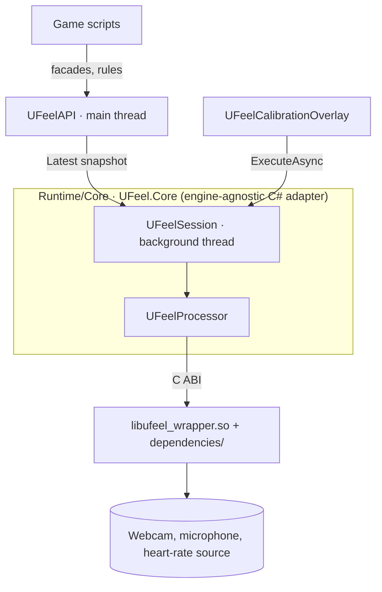

# Architecture

> [<- Back to README](README.md)

The UFeel Unity Game Hub is a Unity project demonstrating the **UFeel** native library (emotions, eye tracking, speech to text, heart rate).

## Package (`Packages/com.ufcorp.ufeel`)

| Path | Role |
| --- | --- |
| `Runtime/Core/` | C# adapter synced from the ufeel package (`tools/update-ufeel.sh`). Do not edit here, change it in the ufeel repo. |
| `Runtime/UFeelAPI.cs` | Unity host: starts the session, loads the calibration profile, evaluates rules in `Update`, disposes on quit. |
| `Runtime/Facades/` | `UFeelAPI.Emotion`, `.EyeTracking`, `.SpeechToText`, `.HeartRate`: read the per-frame snapshot and keep the read features running. |
| `Runtime/Calibration/` | IMGUI calibration screen (F8) driving the adapter's `EyeTrackingCalibration`. |
| `Runtime/Microphone/` | IMGUI speech microphone selector (F9, shown in the pause menu). |
| `Runtime/Plugins/Linux-x86_64/` | Native library, `dependencies/` (found through RUNPATH) and `models/`. |
| `Editor/` | Plugin import settings, and the Linux post-build step copying `dependencies/` and `models/` (to `StreamingAssets/UFeel`). |

## Threading

- Native calls run only on the session thread.
- Game code reads immutable snapshots and never blocks.
- Commands (calibration, speech toggle, microphone selection) are queued through `UFeelSession.ExecuteAsync`.

## Project layout (`Assets`)

| Path | Role |
| --- | --- |
| `Hub/` | `GameHub` scene: first-person lobby with the door carousel, door selection (keyboard, dropdown or eye tracking) and additive loading of the games. `Hub/Editor/` holds the carousel builder (**Tools > Game Hub > Carousel Builder**) and its `CarouselLayout.json`. |
| `Common/` | Code shared by the hub and the games: keyboard-layout-aware input, gaze direction, first-person controller, pause menu, return to the hub, heart rate tempo, tags and scene names. |
| `Games/<Category>/<Game>/` | One folder per game (`Scenes`, `Scripts`, and the game's own `Prefabs`, `Materials`, `Audio`, `Sprites`, `Textures` or `Models`). |
| `ThirdParty/` | Imported packs and models, kept as distributed. |
| `Settings/` | URP assets and the Input System actions. |

## Assemblies

Each feature compiles into its own assembly, named after its root namespace. Game assemblies never reference each other.

| Assembly | Folder | References |
| --- | --- | --- |
| `GameHub.Common` | `Common/Scripts` | `UFeel`, `UFeel.Core`, Input System |
| `GameHub.Hub` | `Hub/Scripts` | `GameHub.Common`, `UFeel`, `UFeel.Core`, TextMesh Pro, UI |
| `GameHub.Hub.Editor` | `Hub/Editor` | `GameHub.Hub` |
| `GameHub.RhythmGame.Editor` | `Games/HeartRate/RhythmGame/Editor` | `GameHub.RhythmGame` |
| `GameHub.Maze`, `GameHub.Animals`, `GameHub.Car`, `GameHub.Survivor`, `GameHub.HorrorRoom`, `GameHub.RhythmGame`, `GameHub.EscapeRoom` | `Games/<Category>/<Game>/Scripts` | `GameHub.Common`, `UFeel`, `UFeel.Core`, and UI or TextMesh Pro when used |

## Scene flow

The hub loads a game additively when the player enters a door. A game whose root object is named `Root` is placed behind the door, otherwise the hub player and environment are hidden. Games return to the hub with `GameFlow.ReturnToHub()`, which reloads the `GameHub` scene and stops speech detection. A door shows "In Progress" when flagged so or when its scene is not in the build settings.

**See also:** [API Reference](Packages/com.ufcorp.ufeel/Runtime/API.md) - [Setup Instructions](Documentation/GameHub/SetupInstructions.md)
