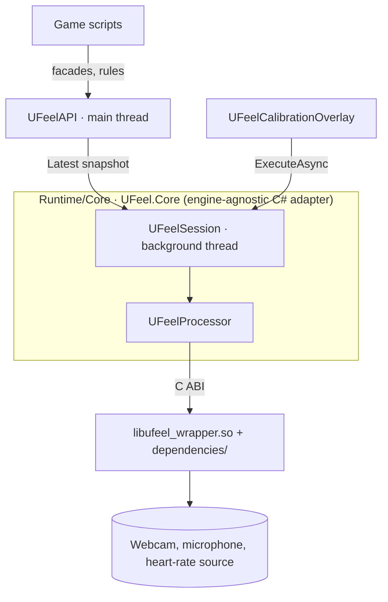

# Architecture

> [<- Back to README](README.md)

The UFeel Unity Game Hub is a Unity project demonstrating the **UFeel** native library (emotions, eye tracking, speech to text, heart rate).

## Package (`Packages/com.ufcorp.ufeel`)

| Path | Role |
| --- | --- |
| `Runtime/Core/` | C# adapter synced from the ufeel package (`tools/update-ufeel.sh`). Do not edit here, change it in the ufeel repo. |
| `Runtime/UFeelAPI.cs` | Unity host: starts the session, loads the calibration profile, evaluates rules in `Update`, disposes on quit. |
| `Runtime/Facades/` | `UFeelAPI.Emotion`, `.EyeTracking`, `.SpeechToText`, `.HeartRate`: read the per-frame snapshot and keep the read features running. |
| `Runtime/Calibration/` | IMGUI calibration screen (F8) driving the adapter's `EyeTrackingCalibration`. |
| `Runtime/Microphone/` | IMGUI speech microphone selector (F9, shown in the pause menu). |
| `Runtime/Plugins/Linux-x86_64/` | Native library, `dependencies/` (found through RUNPATH) and `models/`. |
| `Editor/` | Plugin import settings, and the Linux post-build step copying `dependencies/` and `models/` (to `StreamingAssets/UFeel`). |

## Threading

- Native calls run only on the session thread.
- Game code reads immutable snapshots and never blocks.
- Commands (calibration, speech toggle, microphone selection) are queued through `UFeelSession.ExecuteAsync`.

## Testing Room (`Assets/Scripts/TestingRoom`)

First-person experience used to validate the UFeel package: room navigation, carousel, doors, and scene transitions driven by UFeel rules. TODO: remove "testing room" from the entire project by replacing it with "game hub".

**See also:** [API Reference](Packages/com.ufcorp.ufeel/Runtime/API.md) - [Setup Instructions](Documentation/TestingRoom/SetupInstructions.md)
