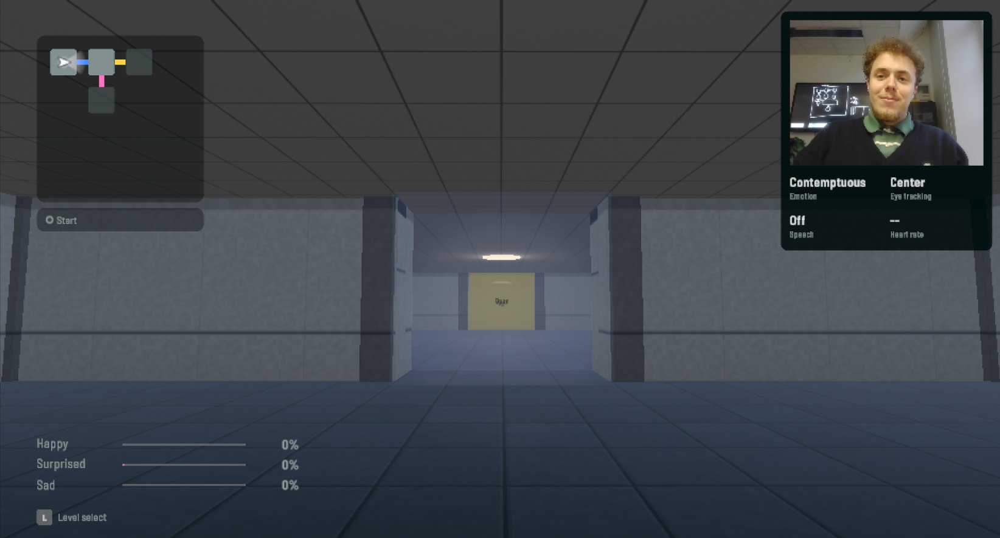

# Maze

> [<- Scene Reference](../../GameHub/Scenes.md)

## Role

Emotion-driven labyrinth experience.

## Gameplay

- The Maze opens on a level select. Only Level 1 is unlocked at first; clearing a level unlocks and starts the next one. Clearing the last level unlocks **Unlimited**, an endless series of growing mazes.
- Each maze is randomly generated.
- Each door asks for an emotion. The closest door is outlined; hold its emotion for about two seconds and the fog clears so you can walk through.
- Some doors close behind you or only open from one side.
- Special rooms: **Hint** (shows the way out), **Bonus** (reveals the map around), **Trap** (back to the start).
- The minimap (top left) fills in as you explore.

| Key | Action |
|---|---|
| L | Back to the level select |
| M | Pause |

## Objective

Reach the exit of each level.

## Levels

Levels are assets in `Assets/Games/Emotions/Maze/Levels`:

- `MazeCatalog`: the levels in play order, the available emotions with their door colour (Happy, Surprised, Sad, Angry, Fearful, Disgusted by default) and the Unlimited settings. It is assigned to `MazeManager` in the Maze scene.
- `MazeLevelDefinition` (**Create > GameHub > Maze > Level**): grid size, door emotions (among the catalog's), loop / closing / one-way door ratios, number of hint, trap and bonus rooms, and room shape weights.

Progress is stored in `PlayerPrefs`. It can be reset from the level select or with **Reset saved progress** in the `MazeCatalog` context menu.

## Main Script

`MazeManager`
