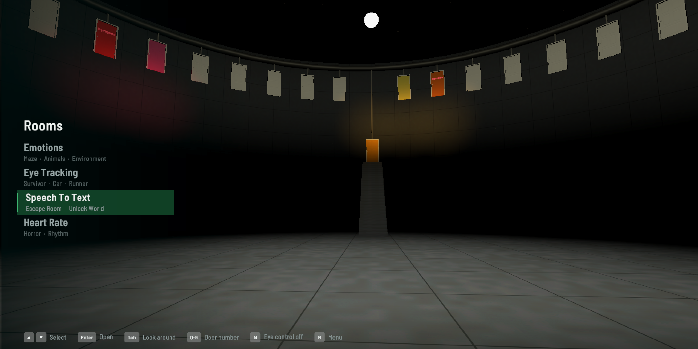

# Game Hub

> [<- Back to README](../../README.md)

Unity project showcasing the [UFeel](../../Packages/com.ufcorp.ufeel) biometric input package through a hub of small games.

## Features

- First-person hub with a door carousel leading to each game
- Door selection with the keyboard, a dropdown or eye tracking
- Games driven by emotion detection, eye tracking, speech to text and heart rate
- Additive scene loading, one assembly per game

## Technologies

- Unity 6000.0.58f2 (URP)
- UFeel (emotion detection, eye tracking and speech to text through the webcam and microphone, heart rate through a sensor)
- C#, Unity Physics and the Input System

## Keyboard shortcuts

Movement uses the key positions (WASD on QWERTY, ZQSD on AZERTY). Letter shortcuts follow the keyboard layout.

| Key | Action |
|---|---|
| **WASD / ZQSD / Arrow keys** | Move around |
| **Mouse** | Look around |
| **E** | Enter the door in front of you |
| **N** | Toggle door selection with the eyes (look left or right then back to the center, double blink to confirm) |
| **F** | Toggle faster carousel rotation |
| **Tab** | Toggle between looking around and using the door selection panel |
| **M** | Toggle the pause menu |
| **F8** | Eye-tracking calibration |
| **F9** | Microphone selector |

## Documentation

| Document | Description |
|---|---|
| [Setup Instructions](SetupInstructions.md) | How to run the project |
| [Scene Reference](Scenes.md) | Scene-by-scene breakdown |
| [Testing & Debugging](TestingTips.md) | Testing and debugging guide |
| [API Reference](../../Packages/com.ufcorp.ufeel/Runtime/API.md) | UFeel Unity API |
