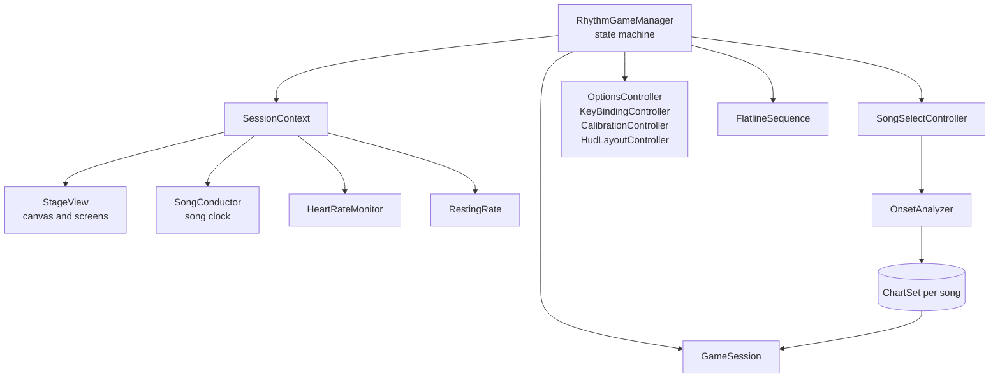
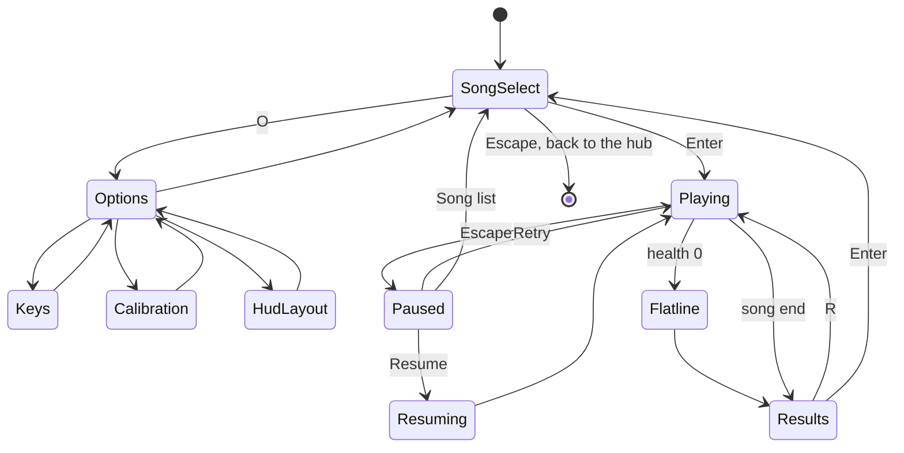
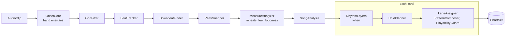
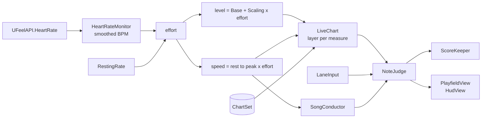

# Rhythm Game

> [<- Scene Reference](../../GameHub/Scenes.md)

## Role

Four-lane rhythm game in the style of osu!mania. The heart rate sets the difficulty.

## Gameplay

- Pick a song, set **Base** and **Scaling**, and play.
- Hit notes on the judge line. Hold long notes until their tail.
- Notes are arrows or circles (Options > Note style). Keys show under the judge line (Options > Show keys).
- Level: `Base + Scaling x effort`, from 1 to 16. Effort is 0 at the resting heart rate and 1 at 50 BPM above it.
- Upcoming notes change with the level.
- Misses drain the health bar. An empty bar ends the run in a flatline.
- The screen edges flash with each heartbeat (Options > Heart flash).

## Resting Heart Rate

- Measured in song select: the lowest steady value over 30 s.
- Measurement only lowers it, so a rising heart rate in the menus does not raise it.
- Set it by hand in Options > Resting heart rate.
- Kept between sessions.

## Song Speed

Options > **Speed at rest** and **Speed at peak**, from 50% to 200%. Both 100% by default: the song keeps its tempo.

- Speed goes from rest to peak with effort, by at most 5% per second. The pitch follows.
- Judgement windows and scroll time stay in real time.
- Charts get lighter when the song is faster and denser when it is slower. Notes per real second match the level, and gaps stay within 10% of it.
- Level and score multiplier are unchanged.
- Range, step and change rate: `TempoSettings`.

## Difficulty

Rows of `DifficultyTable` (`Scripts/Difficulty`). Levels between rows are interpolated.

| Column | Meaning |
| --- | --- |
| `notesPerSecond` | Density in loud sections |
| `minGapMs` | Smallest gap between two notes |
| `minJackMs` | Smallest gap between two notes in the same lane |
| `maxChord` | Most notes at once, holds included |
| `chordShare` | Share of notes in chords |
| `holdShare` | Chance for a note to become a hold |
| `maxBurst` | Longest run of notes under 100 ms apart |
| `overmap` | Grid steps finer than the music allowed |

Slider ranges, steps and the heart rate span: `DifficultySettings`.

## Judgement

| Judgement | Window | Accuracy | Points |
| --- | --- | --- | --- |
| Perfect | ±35 ms | 100% | 300 |
| Great | ±70 ms | 67% | 200 |
| Good | ±110 ms | 33% | 100 |
| Meh | ±150 ms | 17% | 50 |
| Miss | over 150 ms late | 0% | 0 |

- Hold tails: windows x1.5. Early release is a Miss.
- Points x combo tier (x2 from 25, x3 from 50, x4 from 100) x `1 + 0.1 x (level - 1)`.
- Grades: SS ≥ 98%, S ≥ 94%, A ≥ 88%, B ≥ 78%, C ≥ 65%, D below, F on flatline.

## Main Script

`RhythmGameManager`

## Keyboard Shortcuts

| Key | Action |
| --- | --- |
| **D F J K** or **← ↓ ↑ →** | Lanes (Options > Keys) |
| **Tab** / **Shift + Tab** | Next / previous song |
| **↑ ↓** | Select Base or Scaling, move in other lists |
| **← →** | Change the selected value |
| **Shift** | Fine steps with **← →**: 0.1 on sliders, 1 elsewhere |
| **Enter** | Play, confirm |
| **O** | Options |
| **Escape** | Back, pause in game, the hub pause menu from the song select |
| **R** | Retry from the results |
| **F3 / F4** | Scroll slower / faster in game |
| **F5 / F6** | Audio offset −5 / +5 ms in game |

The mouse works in every menu.

## Adding a Song

**Tools > Rhythm Game > Add Song**, or right-click an audio clip > **Add to Rhythm Game**.

1. **Import file...** (mp3, ogg, wav) or drop a clip. `Artist - Title` file names fill both fields.
2. BPM, first beat and preview start are detected.
3. **Listen with clicks**: clicks should fall on the beats, the loud one on each bar start.
   - Clicks between beats: **1/2 beat**.
   - Twice too fast or slow: **/ 2** or **x 2**.
4. **Add song** (or **Update song** for a song already in the game).

Songs are listed in `Songs/SongLibrary.asset`, in song select order.

## Known Limitations

- Key presses use the frame time.
- Song speed changes the pitch.
- Songs with tempo changes or meters other than 4/4 are not supported.

## Architecture

### Components

### States

### Chart Generation

Runs once per song, on a background thread, for every level from 1 to 16 in steps of 0.5.

### Play Loop

### Folders

| Folder | Content |
| --- | --- |
| `Scripts/Analysis` | Audio analysis and song detection |
| `Scripts/Charting` | Chart generation and live layer selection |
| `Scripts/Difficulty` | Difficulty table and settings |
| `Scripts/Gameplay` | Input, judging, scoring |
| `Scripts/HeartRate` | Heart rate smoothing, resting rate, run statistics |
| `Scripts/Playback` | Song clock, preview, generated sounds |
| `Scripts/Presentation` | Rhythm game screens and widgets, built at runtime from the shared UI kit (`Common/Scripts/UI/Kit`) |
| `Scripts/Flow` | Screen controllers and the game session |
| `Scripts/Settings` | Saved settings and records |
| `Scripts/Songs` | `RhythmSong` and `RhythmSongLibrary` |
| `Editor` | Add Song tool |
